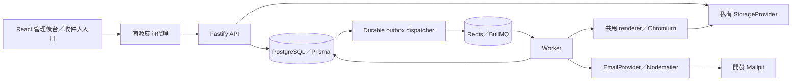

# 架構與決策紀錄

日期：2026-10-15。這是 modular monolith：web、api、worker 可獨立啟動，領域規則和模板契約共用。實作狀態見 [IMPLEMENTATION_STATUS.md](IMPLEMENTATION_STATUS.md)。

## 執行邊界

依賴方向：apps → domain/contracts/renderer/config；renderer 不依賴 API 或資料庫。API 負責驗證與交易；worker 負責受限制的渲染和寄信。PostgreSQL 是業務事實來源；Redis 消失不能抹除證書或寄送結果。

## 官方相容性查核

本輪查核官方文件，實際安裝版本以 package.json 與 pnpm-lock.yaml 為準；不能把下面的相容範圍當作測試證明。

| 元件 | 選擇原則／查核 |
| --- | --- |
| Node.js | 使用 24 LTS；官方清單 2026-10-15 列出 24 與 22 為 LTS，20 已 EOL。[release policy](https://nodejs.org/en/about/previous-releases) |
| Fastify | 維護中的 v5；v4 LTS 已結束。[LTS](https://fastify.dev/docs/latest/Reference/LTS/) |
| Prisma | v7 支援 Node 24、TypeScript 5.4+；client/CLI/adapter 固定相同版本。[requirements](https://www.prisma.io/docs/orm/v7/reference/system-requirements) |
| React／Vite | React 19 系列；Vite 要求 Node 20.19+ 或 22.12+，本案 Node 24 滿足需求。[React](https://react.dev/versions)、[Vite](https://vite.dev/guide/) |
| Playwright | npm 套件、安裝的 Chromium 及容器瀏覽器版本一起固定；升級要重跑 PDF 與視覺測試。[PDF API](https://playwright.dev/docs/api/class-page#page-pdf) |
| BullMQ | 使用維護中的套件版本，細小可重試 job，業務冪等另外用 DB 約束。[idempotent jobs](https://docs.bullmq.io/patterns/idempotent-jobs) |

本輪實際固定：Node 24.21.0、pnpm 11.25.0、Prisma 7.10.0、React 19.3.1、Vite 8.3.4、Fastify 5.12.7、Playwright 1.64.1、BullMQ 6.3.15、Vitest 5.0.4。官方網頁與套件／鏡像 registry 的更新可能不同步；採實際可下載版本，安裝與測試依 lockfile，不把未取得的較新版本當已部署。

## 資料模型與隔離

以下是完整產品的模型責任；Phase 1 可以先保留模型或以欄位合併，不等於全部已有 API。

| 領域 | 模型 | 核心責任 |
| --- | --- | --- |
| 帳號 | User、Session、Invitation、AccountMail | 全域登入、session 撤銷、一次性啟用／重設 token hash；不把 Recipient 當 Membership |
| 組織授權 | Organization、Membership、Role、Permission | 組織狀態、預設角色、自訂角色及不可自我提權 |
| 素材 | Asset、FontAsset | 私有 key、MIME、雜湊、尺寸、來源／授權、字型字重與版本 |
| 模板 | Template、TemplateVersion | 可編輯 draft 和 immutable published JSON；revision 防止靜默覆蓋 |
| 發證 | IssuanceEvent、IssuanceBatch、BatchRow、Recipient | 活動、小批次狀態、穩定 row ID、dry run 錯誤、組織內收件關係 |
| 證書 | Certificate、CertificateRevision | 編號、模板版本、資料快照、PDF 雜湊、生命週期與取代鏈 |
| 寄件 | DomainVerification、EmailConnection、ConnectionGrant、SenderIdentity | 網域證據、真實連線、共享能力及精確寄件地址授權 |
| 郵件 | EmailTemplate、EmailDelivery、DeliveryAttempt | 信件快照、SMTP 回覆、嘗試、message ID、accepted／unknown |
| 可靠性 | OutboxEvent、AuditLog | 交易內待辦、重試、敏感事件與操作者 |

租戶資料建立 `(organizationId, id)` 唯一鍵及對應關聯複合外鍵；多對一不能僅以全域 id 關聯而省略 organizationId。全域 User/Session 和平台共用資源是有意義的例外，不應塞入虛假的 tenant。

完整版本規劃的索引涵蓋 organizationId + updatedAt、batchId + status、recipientId、outbox status + availableAt、session token hash／expiresAt；Phase 1 實際索引以 migration 為準。名單列表需要分頁，不能把整個資料庫下載到瀏覽器篩選。

### Phase 1 的實際合併與缺項

- Permission 採 `packages/domain/src/permissions.ts` 的固定鍵與 `Role.permissions` 字串陣列，沒有獨立 Permission table；Role 已是組織範圍，但自訂角色編輯 API 未提供。
- IssuanceEvent 的名稱先合併到 `IssuanceBatch.eventName`，未提供跨多批次的活動管理實體。
- FontAsset 先由固定 Noto Sans TC／芫荽 Iansui 檔案和 `TemplateVersion.assetManifest` 的版本／hash 表示；沒有組織字型上傳資料表與 UI。
- Certificate 保存不可變 TemplateVersion 引用、dataSnapshot 和輸出 hash；透過 edition 與 previousCertificateId 保留不可變取代鏈，同一 BatchRow 可有多版證書，詳見 LIFECYCLE.md。
- EmailConnection／ConnectionGrant／SenderIdentity 已支援開發 Mailpit 的授權關係；DomainVerification、正式憑證欄位和 EmailTemplate 編輯尚未實作。
- Invitation 是全域 User 的一次性憑證，以 purpose 區分 activation／reset；AccountMail 保存全域帳號服務的 durable 寄送請求，由獨立 certificate-account queue 執行。成員邀請 UI 仍待擴充。

實際 migration 的索引涵蓋已有查詢；outbox 目前以 completedAt + createdAt 掃描，尚無完整排程 availableAt、全組織配額與大型批次分頁。完整模型表是產品目標，不代表上述缺項已有可用後端。

## 登入與啟用

正式密碼採 Argon2id。cookie 存不可猜測 session secret，伺服器驗證 hash 與到期；使用 HttpOnly、SameSite、production Secure。變更資料的請求需要 CSRF 驗證，登入和 token 端點限流。

啟用 token 使用密碼學隨機值，僅存 hash、到期與用途；GET 不消耗，使用者設定密碼時以 POST 原子消耗，重發讓舊 token 失效。既有帳號只加收件關係和通知，不覆寫密碼。密碼重設已實作，原子撤銷全部 sessions；登入建立 session 時鎖定 User 並重新比對 hash，阻止舊密碼與重設併發繞過撤銷。這些決策對應 [OWASP 密碼重設指南](https://cheatsheetseries.owasp.org/cheatsheets/Forgot_Password_Cheat_Sheet.html)。

為避免 token 出現在 access log，啟用連結可把 token 放在 URL fragment，由前端透過 POST 提交；頁面不可載入第三方分析碼。不得在 API response、例外或郵件紀錄輸出 secret。

## 模板與 PDF

共用 renderer 把受限制的 JSON 元素轉為 HTML/CSS，位置／尺寸統一 mm，字級 pt，畫布 zoom 僅影響展示。字型與圖片透過 server 驗證後的資產載入，禁止任意外部 URL、檔案路徑、HTML、script 與 CSS URL。

正式 PDF 使用 Chromium 的 @page、零 margin、printBackground、preferCSSPageSize、精確列印色彩，等待 document.fonts.ready 和圖片完成；缺字、載入失敗、溢位都要中止而不是生成錯誤證書。文字保留文字，不改成整張 screenshot。[Playwright PDF 行為](https://playwright.dev/docs/api/class-page#page-pdf)

發證時保存 TemplateVersion、Recipient 資料快照、字型／背景版本、rendererVersion、PDF storage key 與 SHA-256。worker 不從可變 draft 重新推導舊證書。單張樣張使用同一 renderer，也要受到相同素材與網路限制。

## 工作與失敗語意

API transaction 同時寫業務狀態及 OutboxEvent；dispatcher 重送可能發生，因此每列有穩定 ID、(rowId, edition) 唯一證書與 previousCertificateId 取代鏈、批次 idempotency key 及 job ID；跨批次活動層級的業務發證唯一鍵仍需在獨立 IssuanceEvent 模型加入。worker claim、完成狀態以條件更新保護；重跑不得再建立第二張相同業務證書。已實作產製與寄信各自 queue，限制 Chromium 併發與工作時間；ZIP queue 留待 Phase 2。同一 PDF／郵件以 PostgreSQL advisory lock 序列化，已完成 PDF 重播會同步修正批次狀態。

寄信開始前檢查有效組織、ConnectionGrant、SenderIdentity，記錄 message ID 與 attempt。SMTP 成功只記 accepted；若在送出後寫 DB 前中斷，結果是 unknown，需人工查驗，不能盲目重送。BullMQ retry 本身不提供 SMTP exactly-once 保證。[BullMQ 的冪等工作原則](https://docs.bullmq.io/patterns/idempotent-jobs)

## 儲存、部署與營運目標

本地 filesystem driver 的 key 由系統產生，禁止 path traversal；檔案不掛公開靜態路由。Phase 1 每次授權後讀取 Buffer 回傳單張 PDF；大型檔串流、背景 ZIP 及 S3-compatible driver 仍待實作；已提供 50 MB 內同步 ZIP。未來 S3 採私有 bucket 與短效簽名；S3 未實作前不得宣稱已支援正式儲存遷移。

同源部署讓 session 和 CSRF 範圍清楚。Compose 的 DB、Redis、Mailpit 只能留內部網路或開發 localhost；正式入口只公開 web／API。worker 容器限制 CPU、記憶體、process 數、唯讀根目錄與出站網路。production 管理員 MFA、加密金鑰隔離、備份還原與 worker 故障演練為上線關卡。

營運目標：備份 PostgreSQL 與對應私有資產清單；密鑰另行保管；還原到隔離環境驗證 metadata 與 SHA-256 後才切換。完整執行步驟見後續部署文件，不把尚未演練的 RPO／RTO 當成已達成承諾。

公開驗證與期限判定見 PUBLIC_VERIFICATION.md：查詢時計算有效性，公開回應使用欄位白名單，publicId 不可變，公開 URL 不授予私人 PDF 權限。
